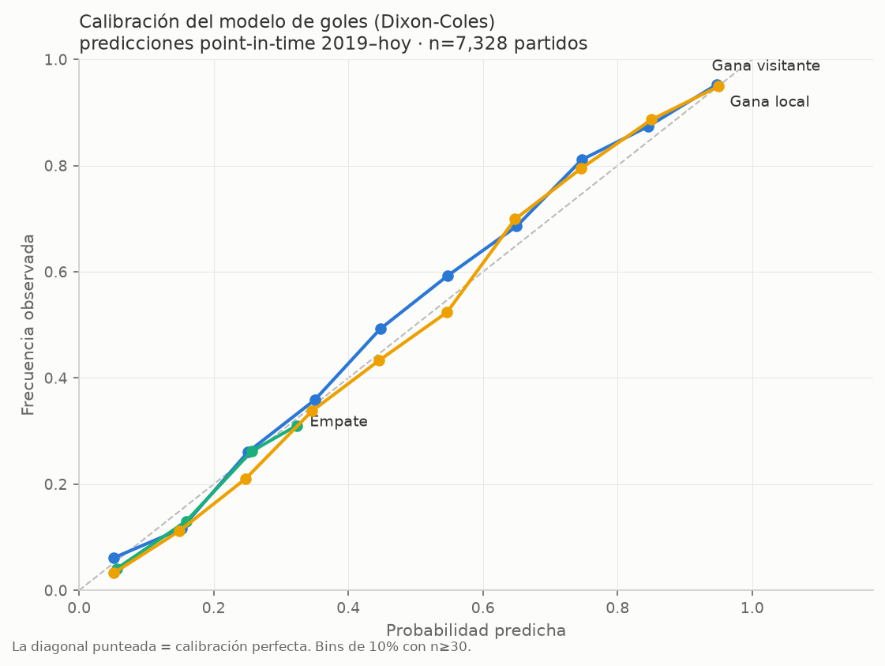

# Modelo predictivo — Mundial 2026


App de Streamlit que ejecuta el pipeline completo (ELO, Poisson, XGBoost,
Dixon-Coles) y simula el torneo con el **cuadro oficial FIFA 2026**.

> *(English)* Probabilistic forecasting system for the FIFA World Cup:
> ELO + Dixon-Coles + calibrated gradient boosting, Monte Carlo tournament
> simulation, and a live Streamlit app. Validated with point-in-time
> backtests on the 2018 and 2022 World Cups (details below).

## 📊 Resultados — backtest point-in-time en Mundiales

¿Cómo le habría ido a **este mismo modelo** prediciendo Mundiales pasados,
sin mirar el futuro? Protocolo: para cada torneo, el modelo se entrena solo
con partidos **anteriores al partido inaugural** (misma receta que producción,
ventana desplazada) y los ratings quedan **congelados** al inicio. Métrica
principal: **RPS** (Ranked Probability Score, menor = mejor — el estándar
para pronósticos 1X2).

| Modelo | Rusia 2018 | Qatar 2022 | 2026 (en curso)\* |
|---|---|---|---|
| Dixon-Coles | **0.2050** | 0.2140 | **0.1598** |
| Ensemble (DC+ELO) | 0.2102 | **0.2119** | 0.1656 |
| ELO logístico | 0.2227 | 0.2191 | 0.1813 |
| Baseline frecuencias | 0.2506 | 0.2349 | 0.2191 |
| Baseline uniforme (⅓,⅓,⅓) | 0.2439 | 0.2387 | 0.2346 |

\* 85 partidos jugados al momento del corte. Tablas completas (LogLoss,
Brier, Accuracy) en [`docs/backtest_mundiales.md`](docs/backtest_mundiales.md);
todo se regenera con `python backtest_mundiales.py`.

**Lectura:** el ensemble bate a los dos baselines sin información en los
tres torneos, de forma consistente. El marcador incluye prórroga pero no
penales (convención del dataset), así que "empate" en eliminatorias
significa definición por tanda.

### Calibración

Diagrama de fiabilidad del modelo de goles con **7,328 predicciones
point-in-time** (walk-forward 2019–hoy, reentrenando con ventana móvil de
8 años y regularización elegida por validación en cada refit). Sobre esa
muestra: RPS **0.168** vs 0.240 del baseline uniforme, accuracy 60.9%.



**Lectura:** las tres curvas siguen la diagonal en todo el rango 0.05–0.95:
el modelo está **bien calibrado** — cuando dice 70%, ocurre ~70% de las
veces. No siempre fue así: la primera versión de esta figura destapó
probabilidades comprimidas, cuyo diagnóstico y arreglo están documentados
abajo.

### Limitaciones y hallazgos (documentados a propósito)

- **Probé binomial negativa** para engordar la cola de goleadas: la
  validación eligió dispersión ≈ Poisson y quedó marginalmente peor que
  Dixon-Coles — los goles internacionales son esencialmente equidispersos.
  Se conserva como fila comparativa en la app, no como modelo.
- **Los empates casi no mueven el ELO** por el factor de margen
  `log(dif_goles+1)`: limitación conocida del diseño actual.
- **Hallazgo → mejora aplicada (grid de regularización):** el diagrama de
  calibración destapó probabilidades comprimidas (modelo conservador). El
  diagnóstico fue la regularización del DC: el grid de `alpha` se quedaba
  corto en 0.01. Se validó un grid extendido en **5 cortes temporales
  2021–2025** (α≈0.001 ganó unánime por deviance Y por RPS; RPS
  out-of-sample ~0.175 vs ~0.20) y se aplicó. Los Mundiales del backtest
  mejoraron: 2018 RPS 0.2274→0.2050, 2022 0.2311→0.2140, 2026 0.2029→0.1598
  (Dixon-Coles).
- **La comparación contra el mercado** (cuotas de cierre) está implementada
  en `backtest.py` (RPS modelo vs mercado, value betting con Kelly), a la
  espera de un histórico de cuotas para los Mundiales pasados.

## Estructura
```
mundial/                  paquete del modelo
  modelo_core.py            ingesta, ELO, Dixon-Coles, ensemble, simulador MC
  analisis_forma.py         expectativa de goles por forma reciente
  ingesta.py                partidos del día (ESPN), contraste, merge
  odds.py                   cuotas: implícita sin margen, blend, The Odds API
  backtest.py               modelo vs mercado (RPS/CLV/value betting Kelly)
  nombres.py                normalización robusta de nombres de selección
  gh_commit.py              persistencia: commit del CSV a GitHub desde la app
app.py + pages/           app Streamlit (7 pestañas + editor del Mundial)
backtest_mundiales.py     backtest point-in-time de Mundiales + calibración
update_results.py         sincroniza el dataset con el upstream (martj42)
scrape_fifa_ranking.py    descarga el ranking FIFA a fifa_ranking.csv
tests/                    pytest (unitarios + smoke de la app)
.github/workflows/ci.yml  CI: ruff + tests + smoke en cada PR
docs/                     resultados del backtest y figuras (regenerables)
results_actualizado_mundial_2026.csv   datos (jugados + fixtures)
MODELO_1_2.ipynb          notebook original (misma lógica)
```

Correr los tests: `pytest -m "not slow" -q` (unitarios, segundos) ·
`pytest -m slow -q` (smoke: renderiza la app completa entrenando el pipeline).

## Ejecutar en local
```bash
pip install -r requirements.txt
streamlit run app.py
```
Se abre en http://localhost:8501

## Pestañas
1. **Simulador Mundial** — corre N simulaciones del torneo y muestra
   probabilidad de clasificar / octavos / cuartos / semis / final / campeón.
   Descarga `probabilidades_mundial.csv`.
2. **Predecir partido** — elige dos selecciones y ve la predicción de cada
   método por separado (Poisson+MC, XGBoost sin calibrar, XGBoost calibrado,
   Dixon-Coles) y el ensemble, más los marcadores más probables.
3. **Análisis de forma** — expectativa de goles a partir de los últimos 12
   partidos oficiales de cada selección: decaimiento temporal, ponderación
   por nivel del rival, ancla al ranking FIFA, historial directo (H2H) y
   corrección de resultados bajos. Muestra el desglose paso a paso.
4. **Resultados del día** — ingesta de los partidos de la jornada (manual o
   con el botón "traer de ESPN"), **contraste** de lo modelado vs el resultado
   real (acierto/Brier/LogLoss acumulados) y **reentrenamiento** con los
   partidos nuevos. ⚠️ El almacenamiento en Cloud es efímero: descarga el CSV
   actualizado para conservar los cambios (re-súbelo al repo).
5. **Ranking ELO** — clasificación ELO (historia completa, 8 años).
6. **Evaluación** — comparativa LogLoss / Brier / RPS / Accuracy de cada
   método, con **validación temporal walk-forward** (robustez fuera de muestra).

### Guardar resultados directo a GitHub (opcional, persistente)
La pestaña "Resultados del día" puede commitear el dataset actualizado de
vuelta al repo (así el reentrenamiento es permanente, no solo de sesión).
Para habilitarlo, en Streamlit Cloud → app → Settings → **Secrets**:
```toml
[github]
token    = "github_pat_xxx"   # fine-grained PAT, repo Axewc/Modelo_mundial, Contents: R/W
repo     = "Axewc/Modelo_mundial"
branch   = "main"
path     = "results_actualizado_mundial_2026.csv"
password = "una-clave-secreta" # protege el botón (la app es pública)
```
El token y la clave NUNCA van al repo (`.streamlit/secrets.toml` está en
`.gitignore`). Sin esta config, el botón se oculta y queda la descarga manual.
Hacer commit a `main` dispara un redeploy (~1-2 min) que reentrena el modelo.

### Cuotas de casas de apuestas (comparativo + blend)
En la pestaña **Predecir partido** se puede comparar la probabilidad del
modelo con la **implícita del mercado** (quitando el margen de la casa) y
mezclarlas (blend, pool logarítmico). Las cuotas se traen de The Odds API;
para habilitarlo, en Streamlit Cloud → Secrets:
```toml
[odds]
api_key  = "tu_api_key_de_the_odds_api"
sport    = "soccer_fifa_world_cup"
provider = "the_odds_api"
```
Sin `api_key`, se pueden **ingresar las cuotas 1/X/2 a mano** (no requiere red
ni clave). El blend con peso al mercado mejora la calibración pero hace que el
modelo "siga" al mercado; úsalo según tu objetivo.

### Mantener el dataset al día (rellenar resultados)
El CSV proviene del dataset comunitario `martj42/international_results`. Para
refrescarlo con todos los resultados nuevos sin perder los fixtures futuros
del Mundial:
```bash
pip install requests pandas
python update_results.py --dry-run   # muestra qué cambiaría
python update_results.py             # actualiza el CSV → commit y push
```
Conserva las filas sin marcador (fixtures por jugar) y deja que el upstream
corrija/agregue los partidos jugados. Para un partido suelto, también puedes
usar la pestaña "Resultados del día" (manual o "Traer de ESPN").

### Ranking FIFA (ancla del análisis de forma)
La pestaña de análisis de forma usa el ranking FIFA como ancla. Para
generarlo (una vez, o cuando FIFA publique uno nuevo):
```bash
pip install requests lxml
python scrape_fifa_ranking.py   # crea fifa_ranking.csv → súbelo al repo
```
Si `fifa_ranking.csv` no existe, la app cae automáticamente al **ELO** como
ancla (no se rompe nada).

## Actualizar resultados (ingesta diaria)
1. Escribe el marcador del partido jugado en
   `results_actualizado_mundial_2026.csv` (rellena `home_score`/`away_score`).
2. En la app, pulsa el menú ⋮ → **Rerun** (o `C` para limpiar caché).
   El modelo se reentrena solo con los datos nuevos.

## Desplegar en Streamlit Community Cloud (gratis)
1. Sube esta carpeta a un repositorio de GitHub (incluye el CSV).
2. En https://share.streamlit.io → New app → elige el repo y `app.py`.
3. Deploy. (El primer arranque tarda porque entrena los modelos; luego
   queda en caché.)

## Parámetros ajustables (en `modelo_core.py`)
- `TAU_DAYS = 2920` — ventana de recencia (8 años). Más alto = más peso a la
  historia/reputación; más bajo = más forma reciente.
- En `app.py`, el slider de **Simulaciones** controla la precisión vs. tiempo.

## Notas
- Si `xgboost` no está instalado, la app sigue funcionando con los demás
  métodos (lo avisa en la barra lateral).
- El cuadro de eliminatorias usa la estructura oficial FIFA 2026 (partidos
  73–104) y la tabla de elegibilidad de los 8 mejores terceros.
